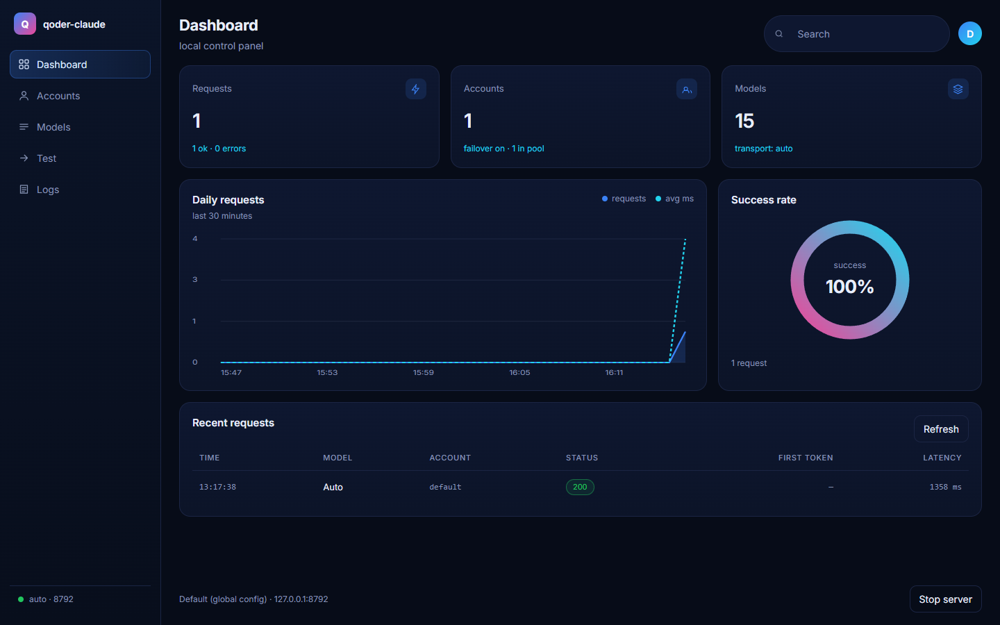

# qoder-claude

[](https://github.com/Ryanabcraft/qoder-claude/actions/workflows/unix-install.yml)
[](https://github.com/Ryanabcraft/qoder-claude/blob/main/package.json)
[](LICENSE)

Run **Claude Code** on **Qoder** models. A local Anthropic-compatible API that keeps your tools,
prompts and shortcuts, and sends the model traffic to your Qoder plan.

**Site:** https://ryanabcraft.github.io/qoder-claude/

**Made by:** [Ryanabcraft](https://github.com/Ryanabcraft)

```
Claude Code  →  qoder-claude  →  api1.qoder.sh
```

## Install

```cmd
curl -fsSL https://raw.githubusercontent.com/Ryanabcraft/qoder-claude/main/install.cmd -o install.cmd && install.cmd && del install.cmd
```

```powershell
irm https://raw.githubusercontent.com/Ryanabcraft/qoder-claude/main/install.ps1 | iex
```

```bash
curl -fsSL https://raw.githubusercontent.com/Ryanabcraft/qoder-claude/main/install.sh | bash
```

It installs Node when missing, the Qoder CLI, Claude Code, the vision engine, the global
`~/.claude/settings.json`, the `qclaude` command and a health check. No server is left running.

## Start

```bash
qclaude
```

That starts the bridge, opens the dashboard at <http://127.0.0.1:8787/ui>, and opens Claude Code.
Closing Claude — `/exit`, Ctrl+C or closing the terminal — stops the bridge. On open, `qclaude`
checks for a new version and asks before updating; a declined version is not asked again. After an
update it prints the changelog notes for the new version, capped at 10 lines with `...` when longer.

| command | what it does |
|---|---|
| `qclaude` | bridge + dashboard + Claude Code |
| `qclaude -p "..."` | forwards everything to `claude` |
| `qclaude --status` | server, account and model list |
| `qclaude --no-browser` | skips the dashboard tab |
| `qclaude --serve` | server only, foreground |
| `qclaude update` | checks and installs the latest version |
| `qclaude notes [version]` | prints the changelog for this install |
| `qclaude uninstall` | removes the app, launcher and settings (asks first) |
| `qclaude uninstall --dry-run` | lists what would be removed |
| `qclaude --no-update` | skips the update check |
| `qclaude --stop` | stops the server |

`qclaude uninstall` backs up accounts to `~/.qoder-claude-accounts-<time>` before deleting them,
cleans only the Claude settings the installer wrote, and keeps your MCP servers and
`permissions.allow`. `--project <dir>` also cleans a project-only install; `--no-backup` skips the
accounts copy; `--remove-exa` removes the Exa MCP when its URL is the qoder-claude one.

## Dashboard



## What works

- `Read`, `Write`, `Edit`, `Glob`, `Grep`, `Bash`, `Agent` and MCP servers — executed by Claude
  Code, unchanged.
- `WebSearch` / `WebFetch` — deferred tools get a schema; the installer adds the Exa MCP in the
  user scope, allowlists the web tools so auto mode does not block them, and routes search through
  Exa (`QODER_NO_EXA=1` skips that step).
- Screenshots — paste an image and the model reads it (`qclaude vision install`).
- `/model`, effort slider, thinking budget, 1M context — the installer wires all of it.
- `Qoder · <model>` statusline.

## Accounts

```bash
qclaude account add work     # browser login, new isolated profile
qclaude account list         # state of each profile
qclaude account use work     # active from now on
qclaude rotation             # failover pool
```

Quota is per account. With more than one, the bridge fails over automatically: a quota, `403`,
`429` or lost session pauses that account and the same request runs on the next one.

## Limits

- **1–2 s per turn** on the direct path; ~2 s on the first request after start.
- A tool call costs an extra round-trip (3–5 s). A web search takes 4–15 s.
- Vision turns run on a bundled image engine, take ~13 s and are not streamed. Only the newest
  image is re-sent; later text turns stay on the direct path.
- The full history goes on every request. 1M context makes that viable, not free.
- Provider-side refusals pass through unchanged.

## Troubleshooting

| Symptom | Fix |
|---|---|
| `claude` not found | reopen the terminal; `qclaude` installs it |
| `Not logged in` | `qclaude account add <name>` |
| Wrong account answering | `qclaude account current`, restart the session |
| Failover never fires | `qclaude rotation` — check `on` and the other accounts |
| `claude.exe is not compatible...` | broken npm copy; `qclaude` ignores it and uses the official build |

## Docs

- Update: `update.cmd` (Windows) or `update.sh` (macOS/Linux) — upgrades in place
- [SETUP.md](SETUP.md) — from-scratch install, manual steps
- [docs/internals.md](docs/internals.md) — transports, sessions, configuration, endpoints
- [pt-BR](readme/README_pt_BR.md) · [Contributing](CONTRIBUTING.md) · [MIT](LICENSE)
