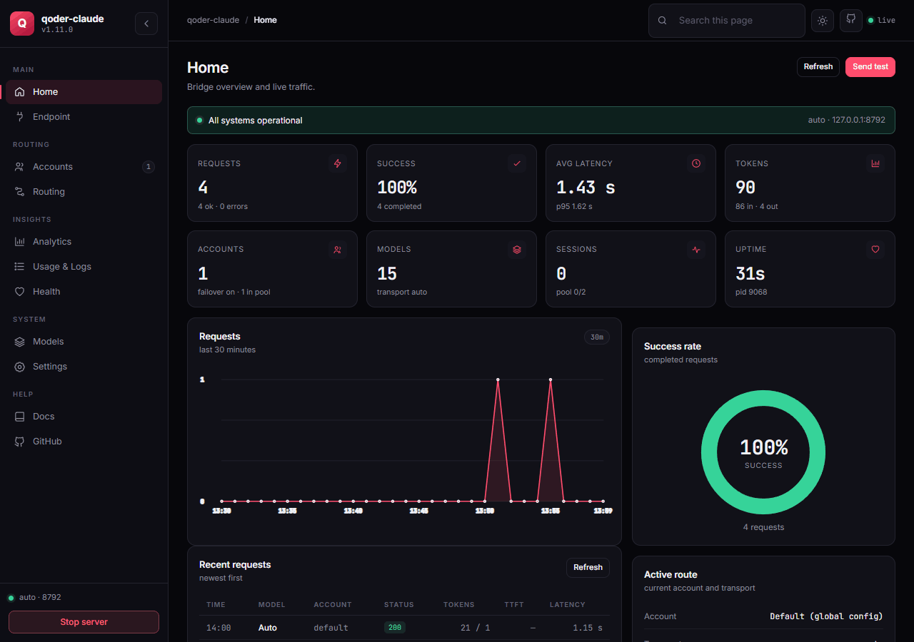

# qoder-claude (Português)


[](https://github.com/Ryanabcraft/qoder-claude/actions/workflows/unix-install.yml)
[](https://github.com/Ryanabcraft/qoder-claude/blob/main/package.json)
[](LICENSE)

Rode o **Claude Code** nos modelos do **Qoder**. Uma API local compatível com a Anthropic que
mantém suas ferramentas, prompts e atalhos, e manda o tráfego do modelo para o seu plano Qoder.

**Site:** https://ryanabcraft.github.io/qoder-claude/

**Made by:** [Ryanabcraft](https://github.com/Ryanabcraft)

```
Claude Code  →  qoder-claude  →  api1.qoder.sh
```

## Instalação

```cmd
curl -fsSL https://raw.githubusercontent.com/Ryanabcraft/qoder-claude/main/install.cmd -o install.cmd && install.cmd && del install.cmd
```

```powershell
irm https://raw.githubusercontent.com/Ryanabcraft/qoder-claude/main/install.ps1 | iex
```

```bash
curl -fsSL https://raw.githubusercontent.com/Ryanabcraft/qoder-claude/main/install.sh | bash
```

Ele instala o Node quando falta, o Qoder CLI, o Claude Code, o motor de visão, o
`~/.claude/settings.json` global, o comando `qclaude` e faz o health check. Nenhum servidor fica
rodando.

## Abrir

```bash
qclaude
```

Sobe a bridge, abre o dashboard em <http://127.0.0.1:8787/ui> e abre o Claude Code. Fechar o
Claude — `/exit`, Ctrl+C ou fechar o terminal — encerra a bridge. Ao atualizar, ele mostra as
notas da versão nova, no máximo 10 linhas, com `...` quando houver mais.

| comando | o que faz |
|---|---|
| `qclaude` | bridge + dashboard + Claude Code |
| `qclaude -p "..."` | repassa tudo ao `claude` |
| `qclaude --status` | servidor, conta e modelos |
| `qclaude --no-browser` | sem a aba do dashboard |
| `qclaude --serve` | só o servidor, em primeiro plano |
| `qclaude update` | verifica e instala a versão mais nova |
| `qclaude notes [versão]` | mostra o changelog desta instalação |
| `qclaude uninstall` | remove o app, o launcher e os settings (pergunta antes) |
| `qclaude uninstall --dry-run` | lista o que seria removido |
| `qclaude --no-update` | pula a checagem de atualização |
| `qclaude --stop` | derruba o servidor |

O `qclaude uninstall` faz backup das contas em `~/.qoder-claude-accounts-<hora>` antes de apagar,
limpa só os settings que o instalador escreveu e mantém seus servidores MCP e
`permissions.allow`. `--project <dir>` limpa também uma instalação project-only; `--no-backup`
pula o backup das contas; `--remove-exa` remove o MCP Exa quando a URL é a do qoder-claude.

## Dashboard



Home, Endpoint, Accounts, Routing, Analytics, Usage & Logs, Health, Models e Settings. Os settings
escrevem `bridge.config.json` e o settings do Claude com backup; o analytics guarda 7 dias.

## O que funciona

- `Read`, `Write`, `Edit`, `Glob`, `Grep`, `Bash`, `Agent` e servidores MCP — executados pelo
  Claude Code, sem mudança.
- `WebSearch` / `WebFetch` — tools deferred ganham schema; o instalador adiciona o MCP Exa no
  escopo user, libera as web tools na allowlist para o auto mode não bloquear e manda a busca pelo
  Exa (`QODER_NO_EXA=1` pula essa etapa).
- Prints — cole uma imagem e o modelo lê (`qclaude vision install`).
- `/model`, slider de esforço, orçamento de pensamento, contexto de 1M — o instalador cuida.
- Statusline `Qoder · <modelo>`.

## Contas

```bash
qclaude account add trabalho   # login no navegador, perfil isolado
qclaude account list           # estado de cada perfil
qclaude account use trabalho   # ativa a partir de agora
qclaude rotation               # pool de failover
```

A cota é por conta. Com mais de uma, a bridge faz failover sozinha: cota, `403`, `429` ou sessão
perdida pausam aquela conta e a mesma requisição roda na próxima.

## Limites

- **1–2 s por turno** no caminho direto; ~2 s no primeiro request após o start.
- Chamada de ferramenta custa um round-trip extra (3–5 s). Busca web leva 4–15 s.
- Turnos com imagem rodam num motor de imagem embutido, levam ~13 s e não são streamados. Só a
  imagem mais nova é reenviada; os turnos de texto seguintes ficam no caminho direto.
- O histórico inteiro vai em cada request. 1M de contexto torna isso viável, não gratuito.
- Recusas do provedor passam intactas.

## Se der problema

| Sintoma | Correção |
|---|---|
| `claude` não encontrado | abra um terminal novo; o `qclaude` instala |
| `Not logged in` | `qclaude account add <nome>` |
| Conta errada respondendo | `qclaude account current` e reinicie a sessão |
| Failover não dispara | `qclaude rotation` — veja `on` e as outras contas |
| `claude.exe is not compatible...` | cópia npm quebrada; o `qclaude` ignora e usa a oficial |

## Docs

- Atualizar: `update.cmd` (Windows) ou `update.sh` (macOS/Linux) — atualiza no lugar
- [SETUP_pt_BR.md](SETUP_pt_BR.md) — instalação do zero, passos manuais
- [docs/internals.md](../docs/internals.md) — transportes, sessões, configuração, endpoints (em inglês)
- [README EN](../README.md) · [Contribuindo](../CONTRIBUTING.md) · [MIT](../LICENSE)
